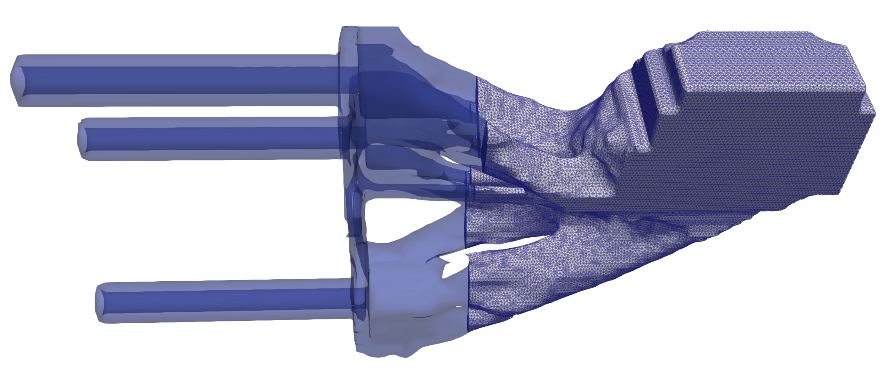

# Implicit2TetMesh.jl

Implicit2TetMesh is an experimental Julia package for generating high-quality tetrahedral meshes from implicit geometries defined by Signed Distance Functions (SDFs), inspired by [isosurface stuffing algorithm](https://dl.acm.org/doi/10.1145/1276377.1276448). Implementation details are provided in the documentation below. For practical usage examples, see [`examples/`](examples/).

<p align="center">
  
</p>

## Features
- **Robust Meshing**: High-quality tetrahedral mesh generation from implicit geometries on the A15 acute lattice (the 27-node, 46-tetrahedron tile of quartet / Doran et al. 2013 — not the body-centred cubic lattice of Labelle & Shewchuk 2007)
- **Edge-based Warping**: Lattice vertices near the surface are snapped onto the cut points of sign-crossing edges (isosurface-stuffing warp), which collapses the sliver tetrahedra
- **Boundary Trimming**: Tetrahedra crossing the surface are trimmed back to the interior with quartet-style `trim_spikes` stencils; a consistent quad-split diagonal keeps the trimmed boundary crack-free. Surface-only ("quadruple-zero") tetrahedra are resolved with a shape filter and quartet's centroid test
- **Exact Geometric Predicates**: Every tetrahedron orientation/inversion decision uses Shewchuk's exact predicates (via [ExactPredicates.jl](https://github.com/lairez/ExactPredicates.jl)) instead of a tolerance-thresholded determinant
- **Geometric Constraints**: Bounded plane definitions for selective node alignment
- **Mesh Operations**: Slicing, isolated component removal, degenerate-element removal, and VTU export with mesh quality metrics
- **Pluggable Input Fields**: structured SDF grids (trilinear), unstructured conforming HEX8 finite-element fields (isoparametric shape functions) and Gaussian RBF interpolants (evaluated directly) behind one interface, with SIMP-density and level-set adapters; the generation lattice stays structured by design
- **Experimental passes (off by default)**: a gated vertex relaxation of the near-boundary layer and a cap recovery for "+000 spike" tetrahedra, see [Experimental passes](#experimental-passes-off-by-default)

## Installation

**Requirements:** Julia LTS (1.10.10)
```julia
# From Julia REPL, press ] to enter package mode
pkg> add https://github.com/jezekon/Implicit2TetMesh.jl
```
or
```
git clone https://github.com/jezekon/Implicit2TetMesh.jl
```
## Main Function
Generate tetrahedral meshes from SDF data:
```julia
generate_tetrahedral_mesh(grid_file, sdf_file, output_prefix; options=MeshGenerationOptions())
```
#### Parameters:
- `grid_file::String`: Path to the JLD2 file containing the grid data
- `sdf_file::String`: Path to the JLD2 file containing the SDF values
- `output_prefix::String`: Prefix for output files (default: "output")
- `options::MeshGenerationOptions`: Configuration options (optional)
#### SDF Convention:
The package uses the standard convention `phi < 0 = inside`, `phi > 0 = outside`, `phi = 0 = on the surface`, matching the isosurface-stuffing reference implementations. Input files that store the opposite sign (positive = inside) are negated automatically when the `BlockMesh` is constructed; the data files on disk are never modified.
#### Surface Warping:
Before the boundary is sliced, lattice vertices close to the surface are snapped onto the **cut points** of their sign-crossing edges, following the isosurface-stuffing warp (Labelle 2007, §3.2). For every tetrahedron edge whose endpoints have opposite SDF signs, the surface crosses the edge at `X_i + α·(X_j − X_i)` with `α = φ_i / (φ_i − φ_j)` (with `cut_points = :bisection`, `α` is instead the zero of the field along the edge, found by bisection); if that crossing lies within a fraction `threshold` (default `0.3`) of an endpoint, the endpoint is moved onto it and marked as lying on the surface. Each vertex is warped to its closest qualifying cut point, and all displacements are computed from the original geometry and applied at once, so the result is independent of vertex order. Moving the vertex along the edge onto its cut point (rather than projecting it to the isosurface in an arbitrary direction) is what keeps the surrounding tetrahedra well shaped and removes the slivers.
#### Surface Tetrahedron Handling:
After trimming, some tetrahedra end up with **all four vertices on the surface** (every node was warped onto a cut point). These "quadruple-zero" tetrahedra are ambiguous — it is not clear whether each one lies inside or outside the geometry — so they are resolved in a second pass:

1. A candidate that is **inverted**, or whose **dihedral angles** fall outside `[10°, 140°]`, is discarded — it is too flat to improve surface fidelity (Labelle & Shewchuk 2007).
2. A well-shaped candidate whose four faces all **adjoin the solid mesh** is **retained** (it fills a pocket in the boundary); every other one is kept only if the **SDF at its centroid** is negative (inside) — quartet's `remove_exterior_tets` rule.

There is deliberately no "no face adjoins → discard as a bubble" rule: adjacency is counted against solid tetrahedra only, so the interior member of a cluster of quadruple-zero tetrahedra would read as isolated and its removal would leave a tetrahedron-shaped hole below the surface. A genuinely floating piece that passes the centroid test is face-disconnected and is removed by the `remove_isolated_components!` pass that follows (it keeps the largest connected component). Where four warped vertices lie on a sub-lattice-thickness thin feature, the boundary can still self-touch (two surface sheets meeting along an edge); such pinches reflect the uniform lattice resolution and are the target of the planned adaptive refinement, not cracks — the trimmed boundary stays free of open (hole) edges.
#### Volume Accuracy:
The mesh volume is an honest discretization of the zero isosurface. Because the boundary is approximated by flat triangles, the meshed volume is slightly smaller than the reference SDF volume wherever the isosurface is curved (about 2.6 % on the beam, 0.3 % on the gripper); this gap shrinks as the lattice is refined, not by moving nodes after meshing.

The package therefore applies **no** post-hoc volume correction. Displacing surface nodes onto a single global SDF level after meshing is equivalent to meshing the `phi = c` isocontour, but done crudely — it degrades the surface fidelity the warp establishes and can produce spiked or inverted elements (the quartet / Labelle reference algorithms have no such step). If an exact target volume is ever required (for example a volume fraction carried over from topology optimization), the recommended approach is to choose the iso-level offset `c` by bisection **before** meshing and run the normal pipeline on the shifted field `phi − c`. That keeps the mesh robust (no spikes or inversions) and preserves the full surface-fidelity guarantee.
#### Geometric Robustness:
All tetrahedron orientation and inversion decisions use **exact geometric predicates** (Shewchuk's adaptive-precision `orient3d`, via [ExactPredicates.jl](https://github.com/lairez/ExactPredicates.jl)) rather than a floating-point determinant compared against a hand-tuned tolerance. The sign of each element's signed volume is therefore decided exactly: there is no threshold to guess and a single shared predicate backs every orientation check in the pipeline. The trimming produces no inverted tetrahedra (none is reoriented on the beam and gripper test geometries), and the plane alignment rejects any node projection that would invert an incident tetrahedron, so it never folds the mesh. A tolerance is kept in exactly one place — to drop genuinely degenerate (near-zero-volume) elements — where it gates the volume *magnitude*, never the sign. `ExactPredicates` is a standard dependency (listed in `Project.toml`) and is installed automatically.
#### Return Value:
- `mesh::BlockMesh`: The generated tetrahedral mesh
- **Output files**: `.vtu` mesh visualization files for Paraview

### MeshGenerationOptions

Configure the mesh generation process with the following options:

```julia
MeshGenerationOptions(;
    scheme::String = "A15",                           # Discretization scheme (only "A15" is supported)
    warp_param::Float64 = 0.3,                        # Warping intensity for plane alignment (0.0 = disabled)
    plane_definitions::Union{Vector{PlaneDefinition}, Nothing} = nothing,  # Cutting planes for BC application
    quality_export::Bool = false,                     # Export detailed quality metrics
    cut_points::Symbol = :linear,                     # Surface cut-point location: :linear or :bisection
    relax::Union{RelaxOptions, Nothing} = nothing,    # EXPERIMENTAL relaxation post-pass (nothing = OFF)
    recover_caps::Bool = false                        # EXPERIMENTAL cap recovery before slicing (false = OFF)
)
```
#### Option Details

- **scheme**: `"A15"` — body-centered cubic acute lattice (the only supported scheme)
- **warp_param**: Node-alignment threshold for `plane_definitions`, as a fraction of the lattice spacing: surface nodes closer than `warp_param · h` to a plane are projected onto it (`0.0` disables the alignment). It is independent of the isosurface warp, whose threshold is fixed at 0.3 (quartet)
- **plane_definitions**: Vector of `PlaneDefinition` objects for boundary plane constraints (the alignment runs only when this is given)
- **quality_export**: When `true`, exports additional quality metrics (Jacobian determinants, dihedral angles, volume ratios)
- **cut_points**: How the surface cut point on a sign-crossing lattice edge is located, in both the warp and the slicing stage. `:linear` (default) estimates it from the two endpoint SDF values, exactly like the quartet reference implementation — accurate when the input is a true signed distance function. `:bisection` finds the actual zero of the interpolated field along the edge (Labelle & Shewchuk 2007, §3.1); use it when the input field is *not* distance-like (e.g. a smoothed SDF), where the linear estimate misplaces surface vertices and flat walls come out dented.
- **relax**, **recover_caps**: experimental passes, OFF by default; with the defaults the output is that of the core pipeline. See [Experimental passes](#experimental-passes-off-by-default).

### Example Usage
```julia
using Implicit2TetMesh

# Basic usage with default options
mesh = generate_tetrahedral_mesh(
    "path/to/grid_data.jld2",
    "path/to/sdf_data.jld2",
    "beam"
)
```
### Advanced Usage Examples
For complete examples with detailed documentation, see [`examples/`](examples/):
```julia
# Run beam example
julia --project=. examples/beam.jl

julia --project=. examples/gripper.jl

# Stanford bunny benchmark + figures (see the header of the script)
julia --project=. examples/bunny/bunny_benchmark.jl
```
___
## Input Field Sources

By default the field comes from a structured SDF grid (the `grid_file` / `sdf_file` above). Internally the mesher reads the field through a **single query**, `eval_sdf`, so the field source is *pluggable*: the same pipeline (lattice fill, warp, trimming, connectivity) meshes either kind of input. The **generation lattice itself always stays structured** — that is a property of isosurface stuffing; only the *source* of the field changes.

Three concrete sources implement the `eval_sdf(source, p)` + `bbox(source)` interface:

- **`StructuredSDF`** — a uniform grid with **trilinear** interpolation. This is the reference path; it reproduces the original behaviour bit-for-bit and is the fast path the auto-detector falls back to.
- **`UnstructuredSDF`** — a conforming 8-node hexahedral (**HEX8**) finite-element mesh. The field at a query point is the isoparametric **trilinear shape-function** interpolation of the nodal values: point location uses a uniform spatial hash over element bounding boxes, and the element's isoparametric map is inverted by Newton iteration to recover the natural coordinates `(ξ, η, ζ)`. A point outside the meshed region returns a positive (exterior) value — the distance to the domain box — which keeps the zero isosurface enclosed.

- **`RBFSDF`** — a Gaussian RBF interpolant with centres on a regular grid (the smoothed SDF exported by rho2sdf.jl), evaluated **directly** at every query point: `f(x) = Σ w_i exp(−(|x − x_i|/σ)²) − shift` over the kernels whose cut-off reaches `x`. Load it with `load_rbf_source(file)` and mesh it with `generate_tetrahedral_mesh(source, prefix; dx = source.h, options = MeshGenerationOptions(cut_points = :bisection))`, so the surface vertices lie on the zero of the RBF field itself.

  **Conforming-mesh requirement (`UnstructuredSDF`).** The HEX8 mesh must be conforming (no hanging nodes) and have positive Jacobians. On a conforming mesh the restriction of the trilinear field to a shared face depends only on the four shared face nodes, so the field is C0-continuous and the zero isosurface is crack-free — the same property the structured trilinear path has. (Per-element interpolation without shared-face consistency would re-introduce the diagonal-choice cracking problem.) The Jacobian sign and index ranges are validated when the source is built.

Because the edge warp uses the scale-invariant cut fraction `α = φ_i / (φ_i − φ_j)` and no gradients, the field only needs the right zero set and the sign near it — it does **not** have to be a true signed distance function, so SIMP density fields and level sets qualify.

### Meshing an unstructured field

Build a source, sample it onto a structured generation lattice with `BlockMesh(source; dx, padding)`, then run the same pipeline through the source-agnostic entry point:

```julia
src  = build_sdf_source(nodes, hexes, nodal_phi)   # auto: grid -> StructuredSDF, else UnstructuredSDF
mesh = BlockMesh(src; dx = 1.0, padding = 2)        # structured lattice over bbox(src) + a padding ring
mesh = generate_tetrahedral_mesh(mesh, "part")      # same pipeline, same output contract
```

- `build_sdf_source(nodes, hexes, nodal_phi; force = :auto, grid_tol = nothing)` picks the source: a uniform tensor-product grid is recognised and built as a `StructuredSDF` (fast path); anything else becomes an `UnstructuredSDF`. `force = :structured` / `:unstructured` overrides the auto-detection.
- `BlockMesh(source; dx, padding = 2)` builds the structured lattice from `bbox(source)` grown by a `padding`-cell ring, with uniform spacing `dx`, caching `eval_sdf(source, ·)` at each lattice corner (the padding ring reads as exterior).

### Adapters

Two adapters convert common topology-optimization inputs to the `phi < 0 = inside` convention:

- **SIMP densities** — `simp_to_sdf_source(nodes, hexes, densities; iso_level = 0.5)`: element-constant densities are averaged to the nodes (volume-weighted over the incident elements) and turned into `phi = iso_level − ρ`, so `phi < 0` exactly where the smoothed density exceeds `iso_level` (solid). `iso_level` defaults to the usual `0.5` threshold and is adjustable.
- **Level set** — `levelset_to_sdf_source(nodes, hexes, nodal_values; inside = :negative)`: a nodal level-set field used directly; `inside` states the input sign convention (`:negative` = already negative inside, used as is; `:positive` = positive inside, negated) so the stored field ends up `phi < 0 = inside`.

> **Verification note.** quartet can only consume structured grids, so there is no cross-validation oracle for unstructured inputs. The unstructured path is instead checked by a **round-trip** (the beam field re-expressed as a HEX8 mesh and forced through the FE path reproduces the structured run within floating-point tolerance) and by watertightness + quality on a genuinely unstructured analytic case — see `test/test_sdf_sources.jl`.

___
## Experimental passes (off by default)

Two optional passes are kept for experiments. Both are **OFF by default** (`relax = nothing`, `recover_caps = false`, pinned by the test suite); with the defaults the pipeline is the core one described above. Neither is part of the published isosurface-stuffing algorithm.

### Gated relaxation (`relax`)

A post-pass that only **moves vertices** (fixed topology) in the one-to-two element layers near the boundary, where the warp and trim steps leave the size variance and the worst dihedral angles. Enable it with `MeshGenerationOptions(relax = RelaxOptions(mode = :uniform))` (or `:quality`), or call `relax_mesh!(mesh, opts)` on a finished mesh. It runs after the final connectivity refresh and before the plane alignment.

- **`:uniform`** proposes a DistMesh spring step `d_v = ω·Σ_j (x_j − x_v)(1 − L₀/|e_vj|)` (Persson & Strang 2004) towards uniform edge lengths; **`:quality`** proposes quartet's maximin smoothing (`optimize_tet_mesh.cpp`) with a fixed candidate pattern instead of random perturbations.
- A move is accepted only if every incident tetrahedron stays positively oriented (exact predicate), its smallest dihedral does not get sharper and its largest does not get wider, and interior vertices stay inside (`eval_sdf < 0`). Hence the minimum dihedral never drops and the maximum never grows.
- Surface vertices are re-projected onto `phi = 0` by bisection along the angle-weighted vertex pseudo-normal (never the SDF gradient), with the bracket clamped to half the local edge length.

Measured with the default `RelaxOptions` (test geometries, `cut_points = :linear`):

| geometry | mode | min dihedral | max dihedral | angles < 10° | angles > 140° | time |
|----------|------|:---:|:---:|:---:|:---:|:---:|
| beam     | off      | 11.28° | 153.21° | 0  | 81   | |
| beam     | :uniform | 18.37° | 131.62° | 0  | 0    | 1.3 s |
| beam     | :quality | 12.88° | 148.38° | 0  | 9    | 0.9 s |
| gripper  | off      | 9.54°  | 155.36° | 11 | 1053 | |
| gripper  | :uniform | 14.67° | 145.18° | 0  | 9    | 13 s |
| gripper  | :quality | 12.68° | 150.43° | 0  | 139  | 11 s |

```julia
RelaxOptions(;
    mode::Symbol      = :uniform,   # :uniform (springs) or :quality (maximin)
    max_sweeps::Int   = 10,         # max Gauss-Seidel sweeps over the active set
    band::Int         = 2,          # active set = surface vertices + `band` rings inward
    omega::Float64    = 0.3,        # spring step factor (:uniform)
    sizing::Symbol    = :uniform,   # :uniform (one L₀) or :curvature (per-vertex L₀)
    alpha::Float64    = 0.5,        # curvature sizing scale: target length ~ alpha / curvature
    h_min::Float64    = 0.0,        # curvature target clamp (0 = auto, 0.5·grid_step)
    h_max::Float64    = 0.0,        # curvature target clamp (0 = auto, 4·grid_step)
    grading::Float64  = 0.3,        # gradient-limit bound g for curvature sizing (Persson 2006)
    frozen::Vector{Int} = Int[],    # node indices never moved
    bisection_tol::Float64 = 1e-7,  # |eval_sdf| tolerance for the surface re-projection
)
```

`sizing = :curvature` (with `mode = :uniform`) gives a per-vertex target length `clamp(alpha / curvature, h_min, h_max)`, gradient-limited over the active-band edge graph (Persson 2006); with fixed topology this concentrates elements only mildly (edge ratios ~1.5–2×). The pass is deterministic (fixed sweep order and candidate patterns).

### Cap recovery (`recover_caps`)

After the warp, a thin layer of "+000 spike" tetrahedra remains: three vertices on `phi = 0`, the fourth just outside, centroid inside. The trimming discards them, so the mesh loses a sliver of volume where the surface bends inward. With `recover_caps = true` the shared outer apex of such spikes is moved onto `phi = 0` along the average inward normal of their bases **before slicing**; the spikes become quadruple-zero tetrahedra that the slice keeps (subject to the same shape filter). Only `X` and `node_sdf` of the apex nodes change, the connectivity does not. Scope: only the pure `+000` pattern; `++00` and `+++0` are not handled, and fans whose base normals diverge by more than 75° are skipped.

___
## Testing
The test suite is assertion-based. It combines **invariant** tests — properties every correct
output must satisfy (watertight boundary, no inverted elements, a single connected component,
node-SDF consistency, positive element volumes) — with **baseline** (regression) tests that pin
exact node/tet counts and the dihedral-angle histogram. The pipeline is deterministic, so the
frozen baselines in `test/helpers/baselines.jl` are an exact, sharp check; an intentional pipeline
change re-freezes that single file.

```bash
# Default run (beam geometry; the fast path)
julia --project=. -e 'using Pkg; Pkg.test()'

# Opt in to the large gripper geometry (slow)
I2TM_TEST_GRIPPER=1 julia --project=. -e 'using Pkg; Pkg.test()'
```

A per-stage beam diagnostic (`test/test_beam_stages.jl`, also runnable standalone with
`julia --project=. test/test_beam_stages.jl`) exports the mesh to a VTU after every pipeline phase,
so a broken stage is named by the failing assertion and can be inspected in ParaView. All test VTU
artifacts are written to `test/output/` (git-ignored). Shared check helpers and the frozen
baselines live under `test/helpers/`.

The lattice fill, warp and trimming are cross-validated step by step against quartet, the reference
implementation, on the beam and gripper inputs (`test/quartet_crossval/`, needs a C++ build of quartet);
the method and the last result are in [`doc/VERIFICATION.md`](doc/VERIFICATION.md).

## TODO List
- [ ] Performance of the `cut_points = :bisection` path: the redundant field evaluations in the warp, the slicing and the A15 cell skip are cached; open items (surface-node search of the plane alignment, faster root finder) in [`doc/PERFORMANCE_TODO.md`](doc/PERFORMANCE_TODO.md)
- [ ] Optional adaptive refinement for thin features (walls thinner than the lattice spacing); graded transition stencils are published for the BCC lattice only (Labelle & Shewchuk 2007, §6), A15 ones would have to be designed
- [ ] Protection of functional (boundary-condition) surfaces beyond bounded planes, e.g. caller-supplied tagged or non-planar regions, before any surface-moving step
- [ ] Make CairoMakie (used only by the mesh-quality plots) an optional dependency

## Acknowledgments
This package is an experimental tool. Please validate results carefully.
